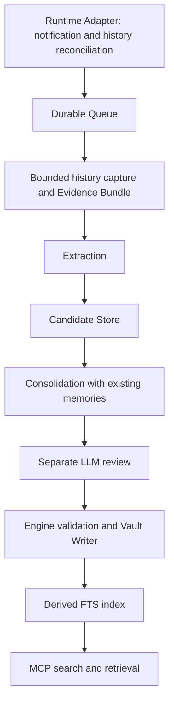

# Design

Status: agreed design baseline, approved on 2026-10-13 (Asia/Tokyo).
Runtime behavior that requires an experiment is identified in
[runtime-research.md](runtime-research.md). Component signatures, schema examples,
and operational defaults below are design contracts, not implemented APIs.

## Purpose and boundaries

Coding Memory captures knowledge from coding-agent work and makes it reusable
across sessions and runtimes. Its primary audience is an agent retrieving a
specific fact, procedure, constraint, or past solution with its evidence and
applicability. Human learning-note curation is outside the initial scope.

The CLI MVP completes one loop: a Codex CLI run produces useful memory that a
different session retrieves and uses through MCP. ChatGPT App's local Codex is the
intended daily-use runtime. Its capture and history access must be investigated
at the beginning, rather than assumed equivalent to the CLI or deferred until
the engine is complete.

The initial deployment is one Mac, one vault, and one worker serving multiple
projects and sessions. Rust is the main implementation language. A thin
TypeScript bridge is acceptable where a runtime's supported interfaces require
it, particularly DSH. Pi capture, semantic search, and an elaborate knowledge
graph are future work.

## Ownership and storage

| Store | Owns | Recovery implications |
| --- | --- | --- |
| `coding-memory` repository | Engine, CLI, MCP server, worker, adapters, configuration contracts, and development documentation | Contains software, not captured personal history |
| `coding-memory-vault` repository | Authoritative Markdown memory notes and their domain metadata | Search can be rebuilt from these notes |
| Local SQLite state | Durable jobs, candidates, run registry, review and application records, and derived search data | Jobs and candidates cannot be reconstructed from the vault |
| Local evidence storage | Captured run evidence, hashes, locators, and coverage metadata | Must be backed up separately if evidence recovery is required |

The local state directory is outside both repositories and is not a third Git
repository. Its exact OS path and SQLite table layout are implementation details.
The MVP may use one SQLite database, provided index rebuilding never resets
durable jobs or candidates. Live SQLite state is not synchronized through Git.

The engine writes Markdown but does not automatically commit or push vault
changes. Git operation and remote synchronization remain manual in the MVP.
Backing up only the vault does not back up candidates or locally captured evidence.

## Pipeline

Notifications are wake-up hints. A notification does not itself prove that the
run succeeded or that its history has finished persisting. The worker confirms
the final outcome and the bounded history before extraction.

### Capture and run identity

- A run follows the runtime's turn boundary, not each individual user message.
  Steering can add instructions to the same run; tool steps are not separate runs.
- Normalize runtime identity, runtime version, runtime instance, session ID,
  native turn identity, outcome, project association, and history boundary.
- Use the runtime's stable native identity for deduplication. Codex and DSH can
  provide different boundary representations; do not force every adapter to
  provide an identical native sequence number.
- Persist the boundary belonging to the detected run. A later worker read must
  not include subsequent turns, and inherited fork history must not become new
  evidence a second time.
- Collect completed, failed, and interrupted runs. Automatic extraction initially
  processes only confirmed completed runs. Tool failures inside a successfully
  completed run remain useful extraction evidence.
- Exclude engine-owned extraction, consolidation, and review runs from capture,
  both in live notifications and in history reconciliation. Child runs should
  not be independently mistaken for new human-requested runs.
- Register projects explicitly and reconcile their stored history from the
  enablement boundary onward. Do not silently ingest all past personal sessions.

The delivery design tolerates duplicate signals and rediscovers missed signals
from persisted runtime history. It does not promise recovery of history that the
runtime never persisted or that was deleted before capture.

### Evidence capture

Capture the user and assistant messages and relevant tool calls and results,
including the links between calls and results. Keep stable evidence locators,
runtime/version metadata, capture boundaries, timestamps, and content hashes.

Where available, retain bounded source artifacts alongside the normalized evidence
used for generation. Distinguish an original recorded artifact from its filtered
representation. Record unavailable, truncated, excluded, or inherited material in
coverage metadata. A recorded tool result is not a guarantee of complete stdout,
all file contents, or attachment bytes.

Once capture is complete, extraction and review use the captured evidence rather
than a mutable, ever-growing runtime session. Extraction must not depend only on
the runtime's last assistant message or on a user-prompt history file.
Publish the durable capture state only after its evidence files have been written
and made durable according to the chosen filesystem policy. Recover or hold a
partially captured bundle rather than treating its metadata as sufficient evidence.

### Extraction

Targets include:

- A failure with an established cause and reusable solution.
- A procedure supported by the observed outcome and its conditions.
- A codebase constraint or an explicitly established design decision.

Progress updates and unsupported guesses are not automatically promoted into
long-term memory. Empty extraction is a successful result when there is nothing
worth saving. Processing failure must remain distinguishable from an empty result.

Each candidate contains a claim or procedure, applicability conditions, proposed
scope, evidence references, and the kind of support it has. The engine validates
the output shape and evidence locators before accepting a candidate. The presence
of a valid locator does not by itself prove semantic support.

### Consolidation and scheduling

The initial configurable trigger is five ready candidates or ten minutes since
the oldest ready candidate became available. Apply the trigger per project so
unrelated projects are not merged into a single undifferentiated batch. Held or
rejected candidates do not repeatedly trigger empty work.

The worker checks these conditions while it is running and has processing
capacity. Sleep or downtime delays processing until it resumes. Ten minutes is a
trigger age, not a guarantee that memory has been published within ten minutes.
An explicit command can request immediate consolidation. An empty batch causes
no generation call.

Consolidation compares candidates with one another and with scoped existing
memories. It proposes:

- Creation of an independent memory note.
- Addition of evidence or a minor correction to the same memory identity.
- Supersession when a premise or conclusion has changed.
- Skipping information already represented without meaningful new evidence.
- Holding an unresolved contradiction or an inadequately supported change.

Differences in version, environment, or applicability must be considered before
declaring a contradiction. Global scope is explicit, not inferred merely from a
missing project ID; proposed general applicability is included in review.

### Review and publication

Use a fresh generation context after the change set is proposed and before any
Markdown is written. Initially the same Codex model can perform generation and
review, with independently configurable models for extraction, consolidation,
and review. Separate contexts are not a claim of statistically independent errors.

The reviewer receives the supporting evidence, candidates, relevant existing
notes, and proposed changes. It assesses evidence support, retained conditions,
scope, duplication, contradiction handling, supersession, and related links. It
returns a decision for each operation: accept, reject, or hold for more evidence.
Accepted operations must form a coherent change set; do not publish an operation
whose link or successor depends on another operation that was not accepted.

The MVP reviews at consolidation time rather than adding a review call to every
extraction. It does not automatically rerun repository code or tests. Failed or
invalid review output does not authorize publication.

The engine independently checks schema validity, evidence-reference existence,
allowed target identities, path containment, revision preconditions, and link
targets. The generation backend never directly edits the vault.

Review acceptance and verification state are separate metadata. Preserve the
difference between direct observations, explicit user statements, and unsupported
inferences. An observed test success supports the recorded test under its recorded
conditions, not every broader conclusion about the implementation. Numeric model
confidence cannot substitute for evidence.

## Memory model and Markdown

Use one file per independent piece of knowledge, with a stable identity that does
not depend on its title or file path. File naming, metadata field names, and schema
versioning should be finalized with parse/serialize fixtures before implementation.

A memory note carries at least:

| Metadata | Purpose |
| --- | --- |
| Identity and schema version | Stable reference and format evolution |
| Title and concise claim or procedure | Agent-readable knowledge |
| Scope and project identity | Retrieval boundary |
| Applicability conditions | Version, commit, branch, environment, or other limits |
| Active or superseded state and successor | Current versus historical retrieval |
| Evidence references and verification state | Support, provenance, and limits |
| Review record | Reviewer/model identity, decision, and policy/prompt version |
| Related memories | Valid Wikilinks to semantically related notes |
| Creation/update metadata | Lifecycle inspection |

The body is normally English. Quotations, code, and identifiers preserve the
original language. Essential applicability and provenance metadata live with the
Markdown rather than only in SQLite. Runtime-native absolute paths can be local
locators, but must not be the sole identity of an evidence bundle.

Minor changes retain the note identity. Supersession creates a successor and
marks the predecessor as superseded. Old notes remain inspectable and normally
leave active search results. A predecessor's evidence is still referenced and
therefore remains retained.

Obsidian is a viewer and editor of the authoritative notes. Detailed manual-edit
detection and holding of subsequent automatic updates are deferred to the App
daily-use milestone. Until then, operation centers on engine-maintained notes;
there is no promise of safe automatic merging with concurrent human edits. Basic
revision-precondition checks still protect application of a stale change set.

## Related links and retrieval

Generate Wikilinks by retrieving a small set of existing, scope-compatible notes
with FTS, then asking generation and review to assess their relationship. Use
identities the engine supplied, validate targets, and abstain when the relation
is unclear. Do not equate a shared keyword with a semantic relationship.

This approach cannot discover a relation if lexical retrieval never finds the
candidate. Evaluate link validity first; vector retrieval and graph traversal can
later improve candidate coverage. Avoid a large generated knowledge graph in the
MVP.

Provide two initial read-only MCP tools, with final names determined during the
protocol fixture work:

- Search: project identity, English terms or code identifiers, result limit,
  and explicit options for historical or other-project scope. Return bounded
  summaries with note identities, applicability, evidence/review state, and score.
- Read: selected note identity. Return the authoritative content and provenance
  metadata, including whether local evidence is available. Superseded notes can
  be inspected deliberately.

Default searches include the requested project's active notes and explicitly
global active notes. Other-project notes require explicit selection. Branch and
worktree share project identity, while their applicability conditions remain
visible in results.

The calling agent forms English queries even when the human request is Japanese.
The MCP server performs local FTS retrieval without an LLM translation step. Agent
instructions encourage search when relevant; they do not guarantee invocation on
every task. Automatic context injection is outside the MVP.

Use SQLite FTS5 as the initial index. Test English terms, punctuation, paths,
identifiers, abbreviations, and scope filtering rather than assuming a default
tokenizer is sufficient. Treat query construction as an engine responsibility,
not unrestricted interpolation into FTS syntax.

## Rust components and contracts

Start with a single Cargo package containing a library and a CLI binary, using
modules for domain data, state, capture, generation, consolidation, vault, search,
MCP, and worker operations. CLI commands and MCP tools call shared engine services.
Separate crates only when an actual boundary or reuse need justifies them.

| Component | Logical contract | Important result distinctions |
| --- | --- | --- |
| Runtime Adapter | Normalize a signal; discover recorded runs since a cursor | Duplicate, eligible, internal, unsupported |
| History Reader | Capture the bounded evidence for a run | Ready, not yet persisted, unavailable, unsupported format |
| Queue / State Store | Enqueue, claim, finish, retry, and retain processing records | Durable registration, lease recovery, held work |
| Generation Backend | Extract candidates, propose consolidation, review a change set | Valid empty output, valid result, timeout, invalid output, failure |
| Vault Writer | Validate and apply a reviewed change set | Applied, already applied, precondition conflict, interrupted |
| Search Index | Refresh or rebuild derived data from committed notes | Fresh, awaiting recovery/refresh, invalid note |
| MCP Server | Search and read with scope and size bounds | Results, empty results, missing note, unavailable service |

These are interface responsibilities rather than promises of final Rust trait
names. Version the external event and generation schemas; keep runtime-specific
decoding out of the shared knowledge model. Choose concrete libraries and pinned
versions during bootstrap, after the integration spikes establish the required
protocol surface.

### Generation backend

Implement Codex CLI execution first. Supply a closed input bundle and JSON Schema,
use a fresh context, collect and validate the final structured output, and record
the backend/model and generation role. Preserve distinguishable exit, timeout,
schema, and review failures. Model choice for memory processing is independent of
the model used for the development run.

The planned isolation controls include avoiding inherited user tooling where
possible, disabling capture hooks and legacy notification, minimizing available
tools/MCP, and explicitly marking engine-owned runs for collector exclusion.
Exact supported flags and behavior require validation; `read-only` does not mean
tools are disabled, and `--ephemeral` does not mean hooks are disabled.

Codex backed by OpenAI is subject to the project's external-transmission policy.
Projects without permission remain held unless an allowed backend is configured;
the MVP does not silently fall back to an external provider. Ollama Local
performance is not an MVP prerequisite. Later backends can directly call Ollama
Cloud or Local, OpenAI APIs, or a Pi model/agent bridge. Distinguish a model API
library from a full agent runtime when assessing the cost of a bridge.

### Worker and operation

Use one worker with short database transactions around registration and state
transitions. Do not keep a SQLite write transaction open across a generation call.
Prevent accidental duplicate worker ownership, retain retry state, and recover
interrupted claims on restart. Bound retries and make held or exhausted work
inspectable instead of silently losing it.

Start the worker at macOS login, with a foreground command for development. Use
explicit executable/config/state locations so the login environment does not
depend on an interactive shell's PATH. Keep the MCP server usable for retrieval
while generation is busy; generation failure must not disable existing memory.

Operational CLI responsibilities include setup/project registration, enqueue,
worker start, immediate consolidation, scoped search/read, status/held-work
inspection, retry, and index rebuild. Final command spelling is an implementation
detail. Logs and status should distinguish no useful knowledge from failure.

Use Rust with SQLite, Markdown/YAML frontmatter, MCP, and a macOS-oriented Nix /
direnv development environment. Keep task automation small and consistent with
the project's tools; no task runner files or dependencies are created by this
design document.

## Applying changes and recovering

SQLite and the filesystem do not share a transaction. Use a durable application
record containing the reviewed operation identities, expected previous revisions,
and intended resulting content hashes before modifying the vault.

For each note, validate the expected revision and use a temporary file plus an
atomic replacement on the same filesystem. Define and test the file, directory,
and SQLite flush policy; atomic visibility alone is not power-loss durability.
Record progress. After interruption,
compare the target with the expected before/after states: resume a still-pending
operation, recognize an already-applied operation, or hold an unexpected conflict.
An application retry must not recreate a note under a new identity.

Finalize candidate consumption only when the relevant application is complete.
Do not let a partially accepted or partially applied supersession invent an
authoritative successor. Refresh search from completed updates; on startup,
resolve pending application records before considering affected index entries
current. The implementation must test how a separately started MCP process
recognizes pending recovery.

Per-file atomic replacement is not whole-batch atomicity. Obsidian may observe an
intermediate multi-file update. The MVP's guarantee is detectable and recoverable
application, not an atomic transaction spanning every file and SQLite.

## Evidence retention and deferred work

Retain evidence referenced by any active or superseded note, unresolved candidate,
or incomplete processing record. Evidence judged to contain no reusable knowledge
and no longer referenced becomes eligible for deletion after 30 days. The cleanup
policy is configurable and can be disabled. Retention is based on references,
not merely on whether an associated job has finished.

Deferred work includes manual-edit protection, failed/interrupted-run extraction,
DSH capture, additional generation backends, automated code/test reexecution,
server-side query translation, semantic search, graph traversal, and Pi capture.
Automatic vault commit/push and multi-machine writers are outside the MVP.
